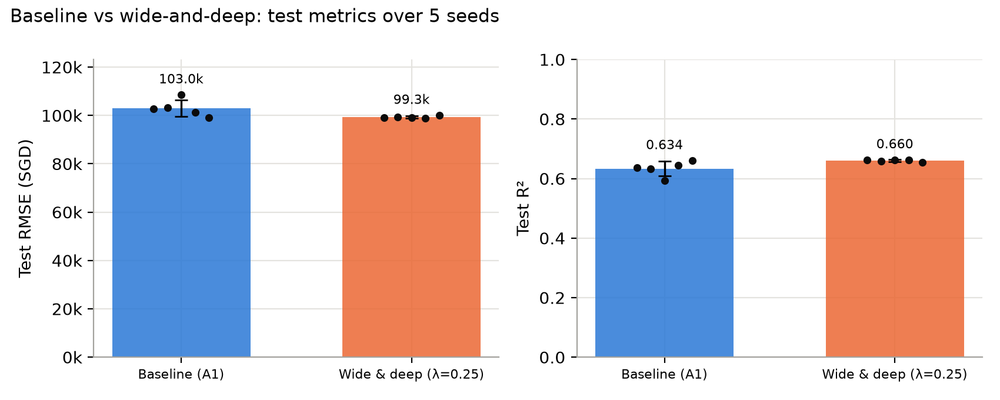
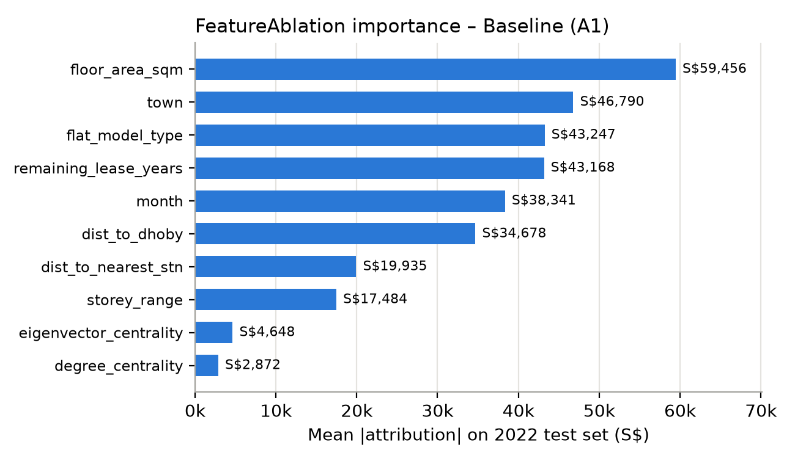
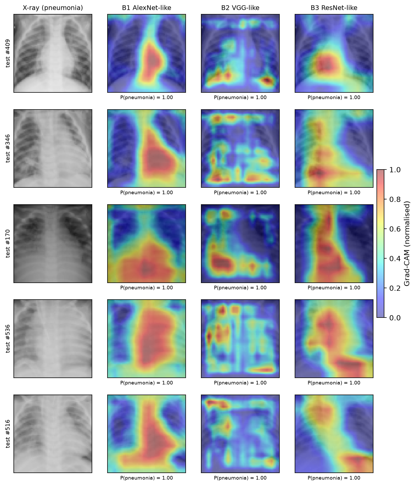

# Deep Learning: HDB Resale Prices & Chest X-ray Classification

Two PyTorch projects built for NTU's SC4001 Neural Networks & Deep Learning course. Every experiment is fully reproducible: seeds are fixed, PyTorch runs in deterministic mode, and dependencies are pinned with [uv](https://docs.astral.sh/uv/).

| | Part A: Tabular regression | Part B: Medical image classification |
|---|---|---|
| **Task** | Predict Singapore HDB resale prices | Classify 64×64 chest X-rays as pneumonia or normal |
| **Models** | Embedding MLP, wide-and-deep network | AlexNet-, VGG- and ResNet-style CNNs |
| **Techniques** | Ray Tune grid search, ablation studies, Captum feature attribution | Learning-rate and batch-size sweeps, FLOP/parameter profiling, Grad-CAM |
| **Code** | [`part-a-hdb-prices/`](part-a-hdb-prices/) | [`part-b-chest-xray/`](part-b-chest-xray/) |

**Tech stack:** Python 3.12, PyTorch, Ray Tune, Captum, pandas, NumPy, Matplotlib, uv

---

## Part A: HDB resale price prediction

The model is an MLP that learns embeddings for categorical features (town, flat model, storey range, month) and combines them with numeric features such as floor area, remaining lease and distance to MRT. It trains on 2017–2020 sales, tunes on 2021 and tests on 2022, so it is always predicting a later year than it was trained on.

**What I did**
- **Hyperparameter search:** Ray Tune grid over hidden width × embedding size. Early stopping is driven by validation RMSE.
- **Ablation study (5 seeds each):** compared the baseline against removing the categorical embeddings and against swapping in sigmoid activations.
- **Wide-and-deep extension:** added a linear "wide" path alongside the deep MLP, with its weight λ tuned on validation data.
- **Explainability:** used Captum feature ablation to rank which inputs drive the predictions.

**Results on the 2022 test set (mean over 5 seeds)**

| Model | Parameters | RMSE (SGD) | R² |
|---|---:|---:|---:|
| Baseline embedding MLP | 3,505 | 103,005 | 0.634 |
| Without categorical embeddings | 641 | 113,018 | 0.559 |
| Sigmoid activations | 3,505 | 97,975 | 0.668 |
| **Wide-and-deep (λ = 0.25)** | 3,544 | **99,271** | **0.660** |

- Wide-and-deep cut RMSE by about 3.7% compared with the baseline. It also made results far more stable across seeds: the RMSE standard deviation fell from 3.5k to 0.5k.
- Removing the categorical embeddings raised the error by about 10%. Location and flat type carry a lot of signal.
- The most important features were floor area, town, flat model and remaining lease.
- Every model under-predicts 2022 prices by a similar amount. This reflects the 2021–22 price surge, which the training years don't contain, and is the main limit of this setup.

<p align="center">
  
  
</p>

## Part B: Pneumonia detection from chest X-rays

I built three CNN families from scratch and compared them on a binary pneumonia-vs-normal task. All three use bias-free convolutions with BatchNorm and ReLU, a binary cross-entropy loss, the Adam optimizer, and early stopping on validation loss.

**What I did**
- **AlexNet-style:** swept learning rates from 1e-5 to 1e-1.
- **VGG-style:** swept batch sizes from 16 to 256 at the best learning rate.
- **ResNet-style:** a residual network, compared head to head on accuracy, sensitivity, specificity, parameter count and FLOPs.
- **Grad-CAM:** visualized which lung regions each model relies on when it flags pneumonia.

**Test-set results**

| Model | Accuracy | Sensitivity | Specificity | Parameters | FLOPs / image |
|---|---:|---:|---:|---:|---:|
| AlexNet-like | 81.3% | 99.7% | 50.4% | 99.6k | 39.1M |
| **VGG-like** | **90.5%** | **99.7%** | **75.2%** | **18.2k** | **19.5M** |
| ResNet-like | 89.1% | 99.5% | 71.8% | 77.2k | 25.3M |

- The VGG-style network was both the most accurate and the smallest: about 5× fewer parameters and half the compute of the AlexNet-style model.
- All three models catch almost every pneumonia case (sensitivity ≥ 99.5%). Their weak point is false positives on normal scans, which is where specificity separates them.

<p align="center">
  
</p>

---

## Running it

Each part is its own uv project. From inside a part's folder:

```bash
uv sync
# Part A
uv run python src/a1_tune.py && uv run python src/a2_ablation.py \
  && uv run python src/a3_wide_deep.py && uv run python src/a4_captum.py
# Part B
uv run python src/b1_alexnet.py && uv run python src/b2_vgg.py \
  && uv run python src/b3_resnet.py && uv run python src/b4_gradcam.py
```

Everything runs on CPU and takes a few minutes per part on an Apple M3. See each part's README for the full protocol, seeds and code map.
